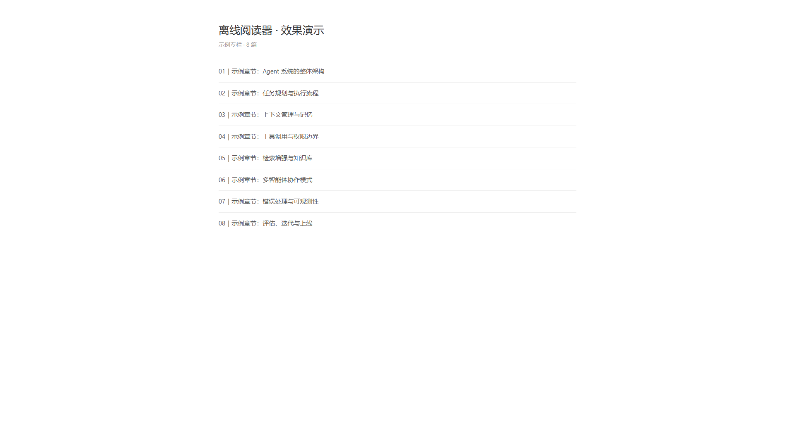
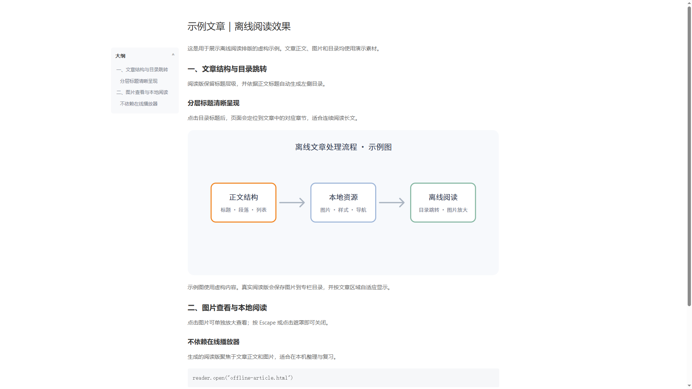
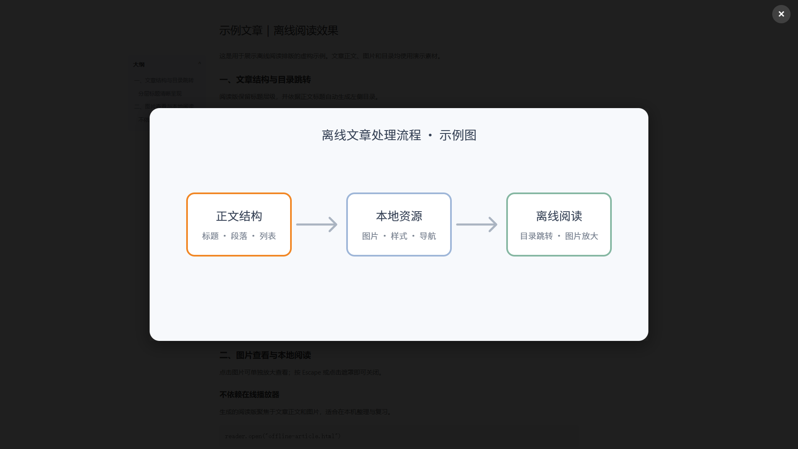

# GeekTime 离线 HTML 阅读器

把已获得阅读权限的极客时间专栏整理为可离线浏览的 HTML。项目重点是尽可能贴近原网页的阅读体验：保留正文层级与文章目录跳转，按原文尺寸呈现图片，并支持点击图片单独放大查看。







## 阅读版特点

- 每个专栏输出到独立的 `专栏名称_HTML阅读版/` 文件夹，包含目录页 `index.html` 和每篇文章的独立 HTML。
- 按正文标题自动生成浮动大纲，点击标题可跳转到文章对应位置。
- 将文章图片保存到本地 `assets/`，按正文宽度显示，点击后可在遮罩层中查看大图。
- 保留标题、段落、列表、代码块等 HTML 内容结构，方便长文阅读。
- 阅读版不写入音频和视频。

## 使用

需要 Python 3 和 `requests`：

```powershell
python -m pip install requests
```

下载一个或多个专栏：

```powershell
python geek_crawler-only-with_vedioandpicture.py --course "专栏名称"
python geek_crawler-only-with_vedioandpicture.py --course "专栏一" --course "专栏二"
```

默认只下载「AI Agent 系统设计面试现场」。也可选择账号下所有可见专栏：

```powershell
python geek_crawler-only-with_vedioandpicture.py --all-courses
```

登录方式：优先从环境变量读取 `GEEKTIME_COOKIE`；也可通过 `--password-login` 使用环境变量 `GEEKTIME_CELLPHONE` / `GEEKTIME_PASSWORD`，未设置时会在终端交互输入。凭据不会保存在源码中。

```powershell
python geek_crawler-only-with_vedioandpicture.py --course "专栏名称" --password-login
```

可选参数：

```text
--no-images       跳过图片下载
--with-comments   保存文章评论
--force           忽略本地完成记录，重新下载所选专栏
```

下载完成后打开 `专栏名称_HTML阅读版/index.html` 即可开始阅读。目录文件和文章 HTML 都保存在本机，便于个人学习与备份。

## 截图说明

仓库中的截图使用虚构的示例标题和示意图，只展示目录、正文排版、锚点跳转和图片放大交互。公开仓库不包含任何专栏正文、原始配图、PDF、音频或视频。

## 使用边界

本项目面向个人学习与已授权内容的离线阅读。请使用自己的有效账号，并遵守极客时间的服务条款、版权及适用法律。请勿将下载的付费课程内容或媒体文件上传、传播或用于商业用途。

本项目与极客时间无关联。
